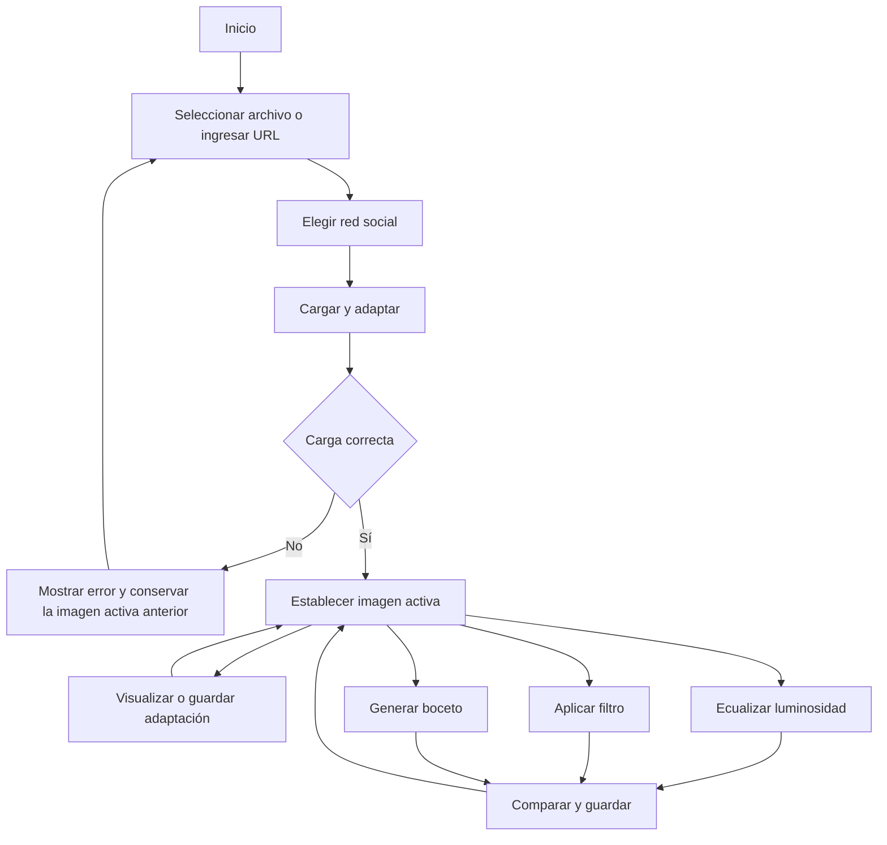

# FotoApp

Trabajo de procesamiento de imágenes de Programación Python Avanzada. La aplicación permite adaptar fotografías a formatos de redes sociales, ajustar el contraste mediante ecualización de luminosidad, aplicar filtros de Pillow y generar bocetos con detección de bordes.

## Archivos de la entrega

| Archivo | Contenido |
|---|---|
| `app.py` | Interfaz local en el navegador mediante Streamlit. |
| `fotoapp.py` | Funciones de carga, adaptación, procesamiento y comparación. |
| `fotoapp_testdev.ipynb` | Desarrollo, demostraciones y análisis de las operaciones. |
| `requirements.txt` | Dependencias de Python y sus versiones. |
| `README.md` | Descripción y ejecución del trabajo. |

## Preparación y ejecución

Desde la carpeta del proyecto, crear y activar un entorno virtual e instalar las dependencias:

```bash
python -m venv .venv
source .venv/bin/activate
python -m pip install -r requirements.txt
```

Iniciar la aplicación:

```bash
python -m streamlit run app.py --server.address 127.0.0.1
```

La aplicación se ejecuta en la computadora local. Permite seleccionar un archivo JPEG o PNG, o ingresar una URL directa a una imagen accesible. El uso de una URL requiere conexión a Internet.

## Fotografías y notebook

Las fotografías y los resultados gráficos no se distribuyen en este repositorio. Para utilizar la aplicación se puede seleccionar una fotografía desde la computadora, sin crear una carpeta de imágenes.

Para ejecutar `fotoapp_testdev.ipynb`, abrirlo en un entorno compatible con Jupyter y seleccionar el kernel del entorno virtual. Configurar las rutas del diccionario `FOTOS` con cinco imágenes locales: una para adaptación, dos para contraste, una para los nueve filtros y un retrato para bocetos. Ejecutar las celdas en orden.

Las rutas predeterminadas del notebook son:

```text
imagenes/redes.jpg
imagenes/oscura.jpg
imagenes/luminosa.jpg
imagenes/filtrar.jpg
imagenes/persona.jpg
```

Los nueve filtros se comparan sobre la misma fotografía. Las técnicas de boceto se comparan sobre el mismo retrato. Para contraste conviene elegir una imagen oscura y otra con exceso de luz que todavía conserven detalles distinguibles.

La aplicación guarda archivos en `results/app/`; la variable de entorno `FOTOAPP_SALIDA` permite elegir otro destino. El notebook genera una carpeta por ejecución dentro de `results/`. Estos archivos permanecen locales.

## Recorrido de la aplicación



Las operaciones de procesamiento se habilitan después de una carga correcta. Cada una parte de la imagen adaptada, sin acumular los efectos de operaciones anteriores.

## Decisiones de procesamiento

- La adaptación conserva las proporciones y centra la fotografía sobre un lienzo con márgenes gris medio RGB `(128, 128, 128)`.
- Los formatos elegidos son YouTube 3840 × 2160, Instagram y Facebook 1080 × 1080, y Twitter/X 1200 × 675. Corresponden a los usos seleccionados para este trabajo, no a todos los formatos posibles de cada plataforma.
- La ecualización modifica el canal Y de YCbCr y conserva Cb y Cr antes de volver a RGB. No recupera información ausente y puede producir pequeñas variaciones cromáticas por las conversiones.
- Los márgenes se separan mediante coordenadas y no participan en el procesamiento ni en los histogramas.
- La comparación de Sobel y Canny permite observar el efecto de los parámetros sobre los contornos del retrato.
