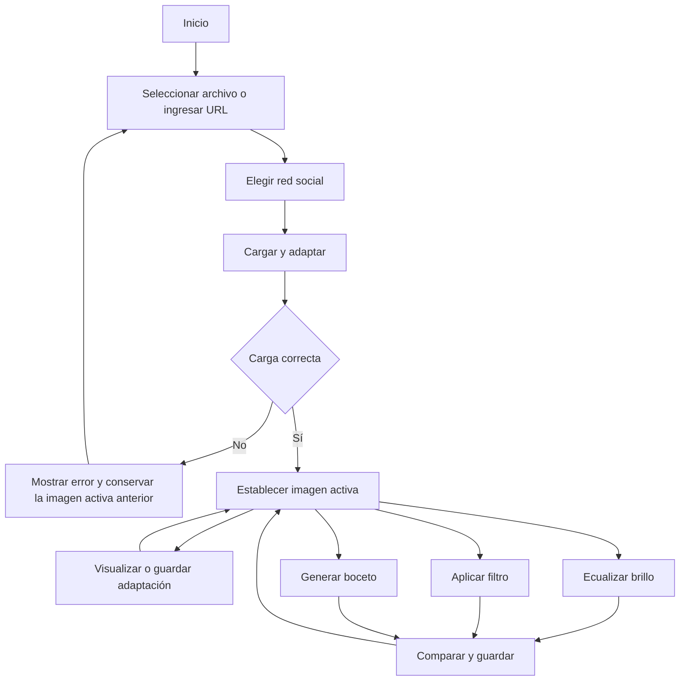

# FotoApp

Trabajo de procesamiento de imágenes de Programación Python Avanzada. La aplicación permite adaptar fotografías a formatos de redes sociales, ajustar el contraste mediante ecualización del brillo, aplicar filtros de Pillow y generar bocetos con detección de bordes.

## Archivos de la entrega

| Archivo | Contenido |
|---|---|
| `app.py` | Interfaz local en el navegador mediante Streamlit. |
| `fotoapp.py` | Funciones de carga, adaptación, procesamiento y comparación. |
| `fotoapp_testdev.ipynb` | Desarrollo, demostraciones y análisis de las operaciones. |
| `requirements.txt` | Dependencias de Python y sus versiones. |
| `README.md` | Descripción y ejecución del trabajo. |

## Preparación y ejecución

Desde la carpeta del proyecto, crear y activar un entorno virtual e instalar las dependencias:

```bash
python -m venv .venv
source .venv/bin/activate
python -m pip install -r requirements.txt
```

Iniciar la aplicación:

```bash
python -m streamlit run app.py --server.address 127.0.0.1
```

La aplicación se ejecuta en la computadora local. Permite seleccionar un archivo JPEG o PNG, o ingresar una URL directa a una imagen accesible. El uso de una URL requiere conexión a Internet.

## Fotografías y resultados

La carpeta `imagenes/` contiene las fotografías de prueba y `results/` las figuras generadas por el notebook, que se reemplazan en cada ejecución. La aplicación guarda sus figuras en `results/app/`, que no forma parte del repositorio; la variable de entorno `FOTOAPP_SALIDA` permite elegir otro destino.

Todas las fotografías son propias.

| Archivo | Uso |
|---|---|
| `redes.jpg` | Adaptación a redes sociales |
| `oscura.jpg` | Contraste: imagen oscura |
| `luminosa.jpg` | Contraste: imagen con exceso de luz |
| `filtrar.jpg` | Nueve filtros de Pillow |
| `persona.jpg` | Bocetos de línea |

Para ejecutar `fotoapp_testdev.ipynb`, abrirlo en un entorno compatible con Jupyter con el kernel del entorno virtual y ejecutar las celdas en orden. Las rutas de las fotografías se definen en el diccionario `FOTOS`, al comienzo del notebook.

## Recorrido de la aplicación



Las operaciones de procesamiento se habilitan después de una carga correcta. Cada una parte de la imagen adaptada, sin acumular los efectos de operaciones anteriores.

## Decisiones de procesamiento

- La adaptación conserva las proporciones y centra la fotografía sobre un lienzo con márgenes gris medio RGB `(128, 128, 128)`.
- Los formatos elegidos son YouTube 3840 × 2160, Instagram y Facebook 1080 × 1080, y Twitter/X 1200 × 675. Corresponden a los usos seleccionados para este trabajo, no a todos los formatos posibles de cada plataforma.
- La ecualización convierte la foto a HSV y modifica solo el brillo (V), conservando el tono (H) y la saturación (S). No recupera información ausente, y en las zonas muy oscuras puede hacer visible ruido de color.
- Los márgenes se separan mediante coordenadas y no participan en el procesamiento ni en los histogramas.
- La comparación de Sobel y Canny permite observar el efecto de los parámetros sobre los contornos del retrato.
