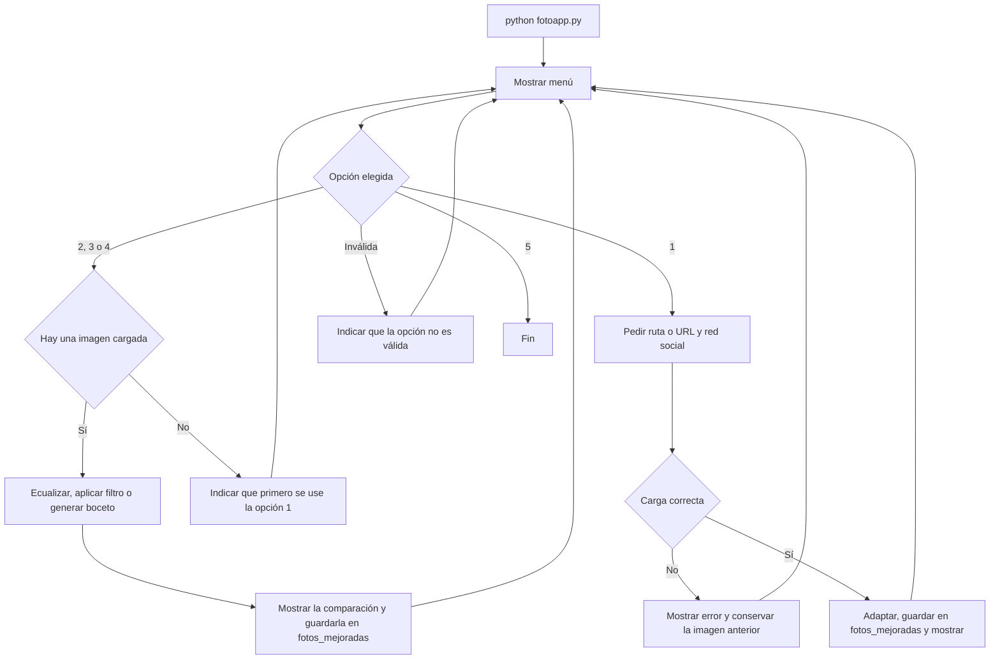

# FotoApp

**Programación Python Avanzada** — Tecnicatura Universitaria en Tecnologías de Programación, 2026

**Autores:** Cristian Arenas y Álvaro Baiza

Esta entrega corresponde a la primera parte del Proyecto 2: procesamiento de imágenes. La aplicación permite adaptar fotografías a formatos de redes sociales, ajustar el contraste mediante ecualización del brillo, aplicar filtros de Pillow y generar bocetos con detección de bordes.

## Archivos de la entrega

| Archivo | Contenido |
|---|---|
| `fotoapp.py` | Módulo con todas las funciones y el menú por consola (`main()`). |
| `fotoapp_testdev.ipynb` | Pruebas de cada función por separado, importando `fotoapp`. |
| `imagenes/` | Fotografías de prueba. |
| `fotos_mejoradas/` | Fotos adaptadas y figuras comparativas generadas. |
| `app.py` | Extra: interfaz web con Streamlit que reutiliza el módulo. |
| `requirements.txt` | Dependencias de Python y sus versiones. |

## Preparación

Requiere Python 3.14. Desde la carpeta del proyecto, crear y activar un entorno virtual e instalar las dependencias:

```bash
python -m venv .venv
source .venv/bin/activate        # Linux y macOS
.venv\Scripts\activate           # Windows
python -m pip install -r requirements.txt
```

## Uso: menú por consola

```bash
python fotoapp.py
```

El menú ofrece cinco opciones: cargar una imagen y adaptarla a una red social, ajustar el contraste, aplicar uno de los nueve filtros, resaltar bordes y salir. La imagen puede ser un archivo local o una URL directa. Las opciones 2 a 4 se habilitan después de cargar una imagen, y cada una parte de la imagen adaptada, sin acumular efectos. Los errores se informan y el menú continúa.

Todos los resultados se guardan en `fotos_mejoradas/`: la foto adaptada (`<foto>_<red>.png`) y las comparaciones lado a lado de la ecualización, los filtros y los bocetos.



## Fotografías y notebook

Todas las fotografías son propias.

| Archivo | Uso |
|---|---|
| `redes.jpg` | Adaptación a redes sociales |
| `oscura.jpg` | Contraste: imagen oscura |
| `luminosa.jpg` | Contraste: imagen con exceso de luz |
| `filtrar.jpg` | Nueve filtros de Pillow |
| `persona.jpg` | Bocetos de línea |

Para ejecutar `fotoapp_testdev.ipynb`, abrirlo en un entorno compatible con Jupyter con el kernel del entorno virtual y ejecutar las celdas en orden. Las rutas de las fotografías se definen en el diccionario `FOTOS`, al comienzo del notebook. Las figuras se guardan en `fotos_mejoradas/` y se reemplazan en cada ejecución.

## Extra: interfaz web con Streamlit

`app.py` muestra cómo reutilizar las funciones de `fotoapp.py` en una aplicación web, sin modificar el módulo:

```bash
python -m streamlit run app.py --server.address 127.0.0.1
```

Se ejecuta en la computadora local y permite elegir un archivo JPEG o PNG o ingresar una URL. Guarda sus resultados en `fotos_mejoradas/app/`, que no forma parte del repositorio.

## Decisiones de procesamiento

- La adaptación escala la foto con una sola proporción, sin deformarla, recortarla ni agregar márgenes: ocupa el tamaño de la red en un sentido y queda igual o más chica en el otro.
- Los formatos de las redes pedidas son YouTube 3840 × 2160, Instagram y Facebook 1080 × 1080, y Twitter/X 1200 × 675. El menú ofrece además TikTok y Snapchat 1080 × 1920, Pinterest 1000 × 1500, LinkedIn 1200 × 627 y Threads 1080 × 1080. Corresponden a los usos seleccionados para este trabajo, no a todos los formatos posibles de cada plataforma.
- La ecualización convierte la foto a HSV y modifica solo el brillo (V), conservando el tono (H) y la saturación (S). No recupera información ausente, y en las zonas muy oscuras puede hacer visible ruido de color.
- La comparación de Sobel y Canny permite observar el efecto de los parámetros sobre los contornos del retrato.
